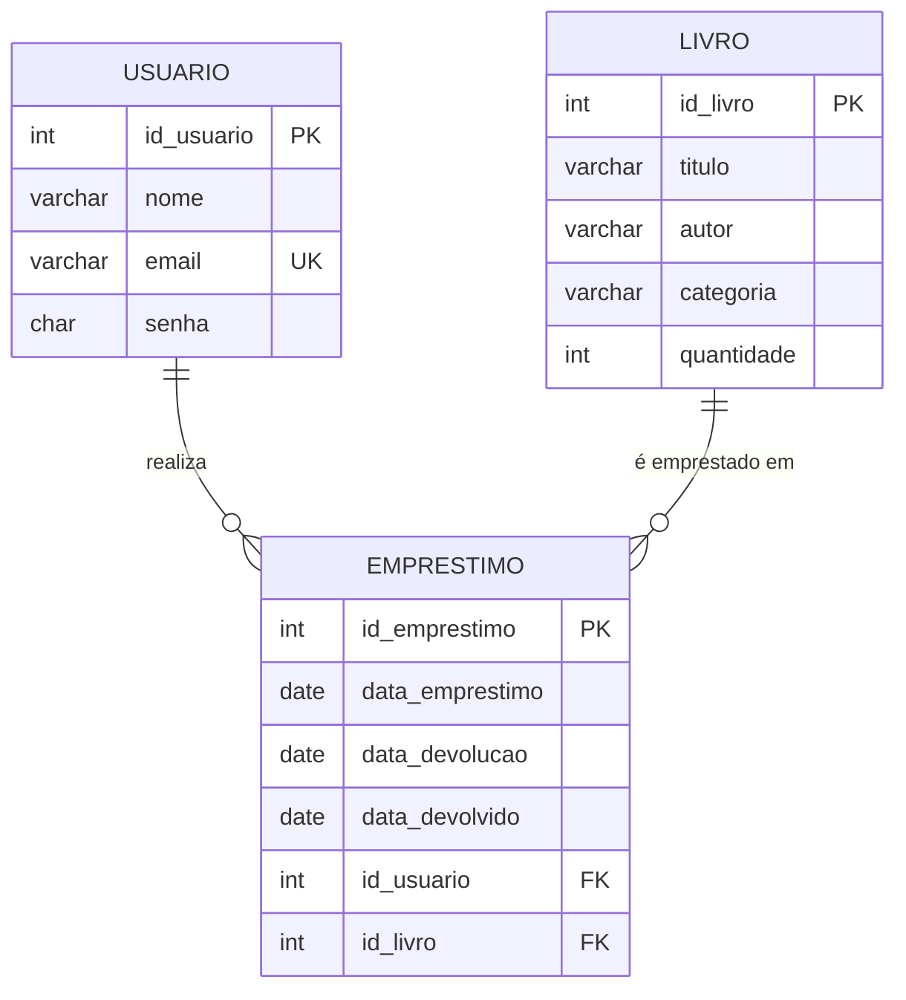

# Atividades-
# Sistema de Biblioteca Escolar – Documentação Técnica

## 1. Requisitos Funcionais

| ID | Requisito |
| --- | --- |
| RF01 | O sistema deve permitir autenticação de usuários por e-mail e senha. |
| RF02 | O sistema deve validar campos obrigatórios e exibir mensagem em caso de acesso inválido. |
| RF03 | O sistema deve permitir cadastrar livros (título, autor, categoria, quantidade). |
| RF04 | O sistema deve permitir consultar/pesquisar livros por título, autor ou categoria. |
| RF05 | O sistema deve permitir editar livros. |
| RF06 | O sistema deve permitir excluir livros sem empréstimos registrados. |
| RF07 | O sistema deve registrar empréstimos, informando usuário, livro e datas. |
| RF08 | O sistema deve bloquear empréstimo de livro sem estoque disponível. |
| RF09 | O sistema deve atualizar automaticamente a quantidade ao emprestar e devolver. |
| RF10 | O sistema deve registrar devoluções. |
| RF11 | O sistema deve exibir o histórico de empréstimos. |
| RF12 | O sistema deve exibir dashboard com total de livros, empréstimos ativos e usuários. |
| RF13 | O sistema deve gerar relatórios de empréstimos e dos livros mais emprestados. |
| RF14 | O sistema deve permitir encerrar a sessão (Sair). |

## 2. Diagrama Entidade-Relacionamento (DER)

Cardinalidades: um usuário realiza **0..N** empréstimos; um livro participa de **0..N** empréstimos; cada empréstimo pertence a exatamente **1** usuário e **1** livro.
`data_devolucao` é a data prevista; `data_devolvido` (NULL enquanto o empréstimo está ativo) registra a devolução efetiva.

## 3. Casos de Teste

| ID | Cenário | Entrada | Resultado Esperado |
| --- | --- | --- | --- |
| CT01 | Login válido | ana@escola.com / 123456 | Acesso liberado ao dashboard |
| CT02 | Login inválido | ana@escola.com / errada | Mensagem "E-mail ou senha inválidos" |
| CT03 | Login com campos vazios | e-mail e senha em branco | Mensagem de campos obrigatórios |
| CT04 | Cadastro de livro | Todos os campos preenchidos, qtd. 3 | Livro salvo e exibido na lista |
| CT05 | Cadastro com quantidade negativa | Quantidade = -1 | Operação bloqueada com mensagem |
| CT06 | Alteração de livro | Editar título de livro existente | Dados atualizados |
| CT07 | Exclusão de livro sem empréstimos | Excluir livro recém-cadastrado | Livro removido |
| CT08 | Empréstimo com estoque | Livro com quantidade > 0 | Empréstimo registrado; quantidade -1 |
| CT09 | Empréstimo sem estoque | "Memórias Póstumas..." (qtd. 0) | Operação bloqueada: "Livro sem estoque disponível" |
| CT10 | Devolução | Registrar devolução de empréstimo ativo | Data de devolução preenchida; quantidade +1 |
| CT11 | Pesquisa de livro | Termo "Machado" | Lista apenas livros do autor |
| CT12 | Relatório dos mais emprestados | Acessar Relatórios | "Dom Casmurro" em 1º lugar (3 empréstimos) |

## 4. Requisitos de Infraestrutura

**Hardware:** processador Dual Core ou superior; 4 GB de RAM; 20 GB de armazenamento.

**Software:** navegador web atual (Chrome, Edge ou Firefox); Node.js 18+; MySQL 8+; servidor web/aplicação (Node.js com Express; opcionalmente Nginx como proxy reverso).

**Rede:** acesso à Internet (instalação de dependências e atualizações); rede local da escola para acesso dos computadores ao servidor.
